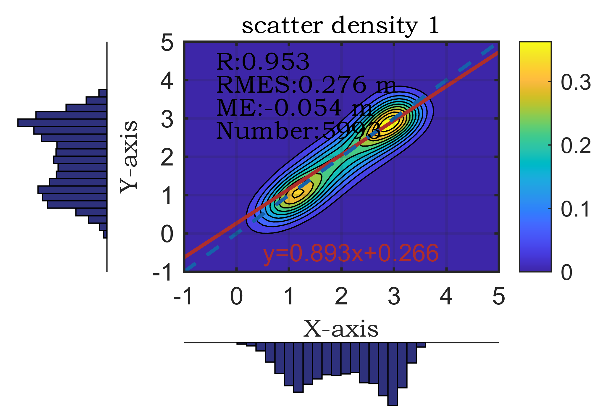
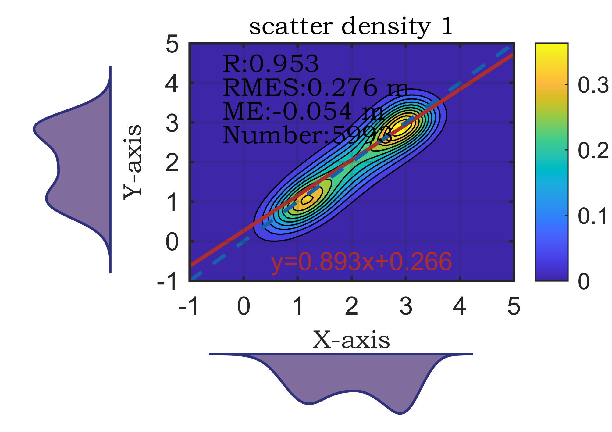

# MATLAB | 21st Research Plotting Issue: Density Scatterplot with Double Bar Chart Enhanced Version

The tutorial for drawing and color data link can be found at the end of this document.
1. The appearance of the figure in an SCI paper is key to its acceptance.
Among them, as shown in the following figure, there are three sub-functions involved.
\n        \n  
\n        \n  
It's necessary to explain why figureWidth should be set to 8.5. This is because when using a double column layout, the space available for inserting figures is limited.
How is it calculated? The A4 paper size is defined by the International Organization for Standardization (ISO) 216: 210mm×297mm. This standard is used worldwide, with most countries adopting this international standard for paper sizes.
The requirements for paper margins on thesis pages are: top (T): 25 mm; bottom (B): 25 mm; left (L): 20 mm; right (R): 20 mm.
This means that thesis pages must be printed on A4 (210mm×297mm) standard white paper, leaving ample blank edges for binding, copying, and annotation. Each side of the paper should have margins of 25mm on the top and bottom, and 20mm on the left and right sides. This is relative to general submission journals.
So, 210mm - 20mm - 20mm = 170mm. In a double column layout, the remaining space for placing images on a single column is only 85mm, which is equivalent to 8.5cm. Only by doing so, the font size in the figure will remain unchanged when imported into Word. If the figure is 10cm wide, after being imported into Word, it will be compressed to 8.5cm, leading to compression of the font size in the figure, no longer being the original 10-point font size. This explains why some SCI papers have different font sizes in each figure.

## Images

<!-- PAYMENT_BLOCK -->

## Get this dataset

- Payment link (Stripe): [Buy now](https://buy.stripe.com/3cs8yP7sY87d0vu9AB)
- Payment QR code: 

<!-- /PAYMENT_BLOCK -->
